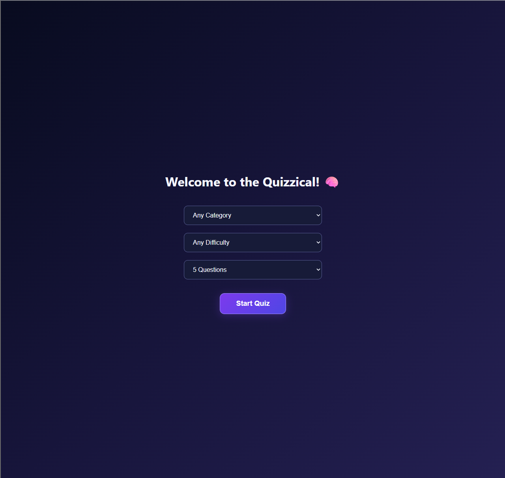
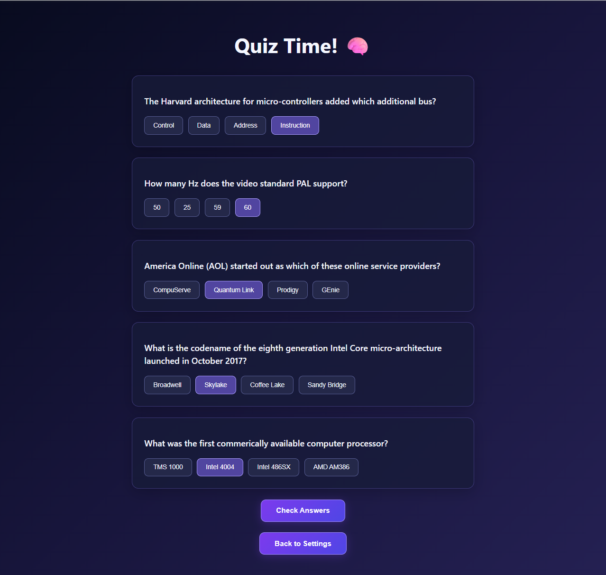
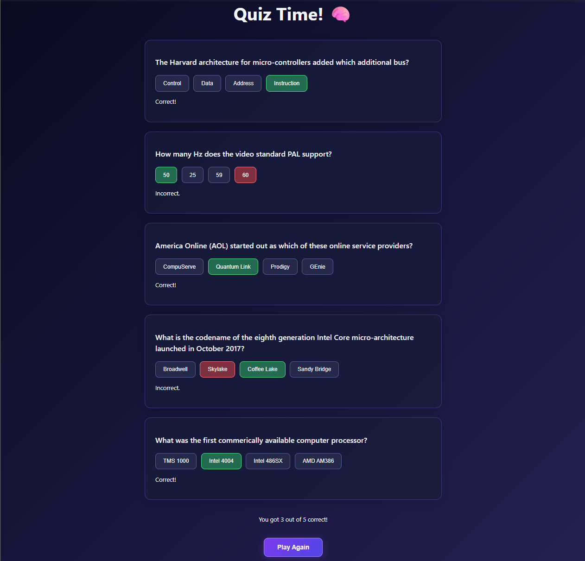

# 🧠 Quizzical

A responsive trivia quiz application built with React, allowing users to test their knowledge across multiple categories and difficulty levels.

Quizzical retrieves questions from the Open Trivia Database API and provides an interactive quiz experience with randomized answers, instant scoring, and customizable quiz settings.

## 🚀 Live Demo

[Play Quizzical](https://quizzical-react-saulstrange.netlify.app/)

## 📸 Screenshots

### Start Screen


### Quiz Screen


### Results Screen


## ✨ Features

- **Customizable quizzes:** Choose a category, difficulty level, and number of questions (5, 10, or 15).
- **Dynamic questions:** Fetches trivia questions from the Open Trivia Database API.
- **Randomized answers:** Shuffles answer choices for each question.
- **Interactive selections:** Highlights selected answers and prevents submission until all questions are answered.
- **Instant results:** Displays correct answers, incorrect selections, and the final score.
- **Replay functionality:** Start a new quiz with the same settings or return to customize them.
- **Responsive design:** Adapts to desktop and mobile screen sizes.
- **Loading and error handling:** Provides feedback during API requests and when requests fail.

## 🛠️ Built With

- React
- JavaScript (ES6+)
- HTML5
- CSS3
- Vite
- Open Trivia Database API
- `he` — HTML entity decoding library

## 🧠 What I Learned

Building Quizzical helped me strengthen my understanding of:

- Managing application state with React's `useState` hook.
- Passing data and callback functions between components using props.
- Fetching and processing asynchronous API data.
- Using conditional rendering to manage different application screens.
- Working with arrays and objects to track user selections and calculate scores.
- Implementing the Fisher–Yates shuffle algorithm.
- Designing responsive interfaces with CSS Flexbox and media queries.
- Deploying a React application using GitHub and Netlify.

## 💻 Running Locally

Clone the repository:

```bash
git clone https://github.com/ScriptSaul/Quizzical.git
```

Navigate into the project:

```bash
cd Quizzical
```

Install dependencies:

```bash
npm install
```

Start the development server:

```bash
npm run dev
```

Open the local URL displayed in your terminal.

## 📚 Acknowledgments

Trivia questions are provided by the [Open Trivia Database](https://opentdb.com/).

Built as a solo project while studying frontend development through Scrimba.